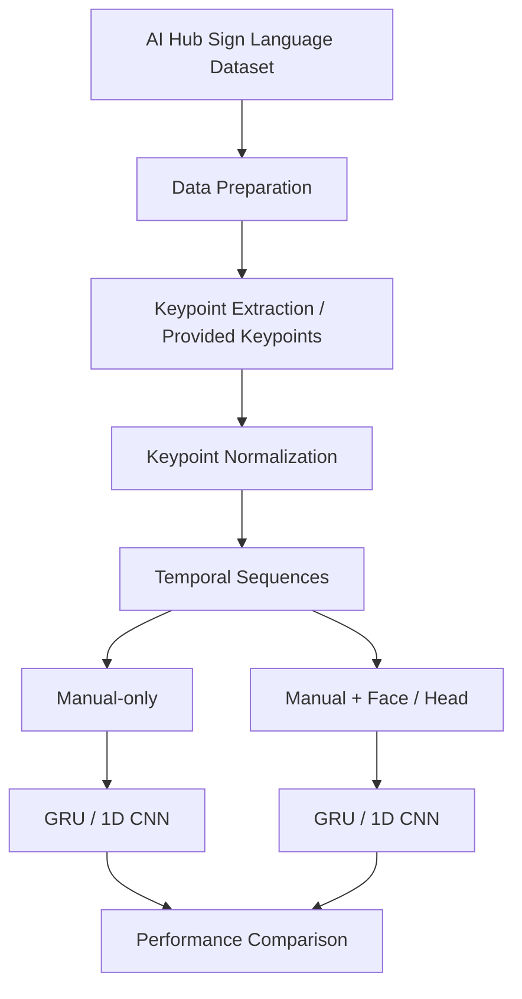

# HAI 2026-2 Team7

**한국수어 인식 및 비수지 표현을 활용한 인식 성능 개선**

Korean Sign Language Recognition with Manual and Non-Manual Feature Fusion

## 프로젝트 소개

손과 상체의 키포인트 시계열로 한국수어 어휘를 분류하고, 얼굴·머리 움직임 특징을 추가했을 때의 성능 변화를 비교합니다. 시간 제약을 고려해 문장 전체 번역보다 제한된 어휘 분류를 우선합니다.

수지(Manual) 표현은 손의 모양·위치·방향·움직임을 중심으로 하며, 비수지(Non-manual) 표현은 얼굴 표정, 시선, 머리·몸의 움직임 등을 포함합니다. 비수지 요소는 단어의 의미 구별과 문법·의도 전달에 관여할 수 있습니다([한국수어 단어 수준 비수지신호 분석](https://www.kci.go.kr/kciportal/landing/article.kci?arti_id=ART001999348)). 본 실험은 손·팔·상체를 Manual 입력으로 묶고 얼굴·머리 특징을 추가하는 조작적 정의를 사용합니다. 신체 부위 기반 분리가 언어학적 구분과 완전히 일치하는 것은 아닙니다.

- **RQ1.** 손과 상체의 키포인트만으로 수어 어휘를 어느 정도 정확하게 인식할 수 있는가?
- **RQ2.** 얼굴 및 비수지 특징을 추가하면 수어 인식 성능이 향상되는가?

## 데이터셋

[AI Hub 수어영상 데이터셋 (103)](https://aihub.or.kr/aihubdata/data/view.do?dataSetSn=103)의 영상 및 제공 키포인트를 활용할 계획입니다. 공식 소개에는 영상, 키포인트 JSON과 다각도 촬영 자료가 안내되어 있습니다. **실제 데이터는 아직 이 저장소에서 확보·분석하지 않았습니다.**

- 수어 어휘 **10~30개 클래스**를 우선 선정할 계획입니다. 확정된 클래스·샘플 수가 아닙니다.
- 손·상체·얼굴 특징을 사용하며 JSON 필드명, 키포인트 수와 좌표 채널은 실제 샘플을 분석해 확정합니다.
- 수연자를 기준으로 분할하고, 동일 수행의 여러 촬영 각도와 파생 시퀀스가 서로 다른 split에 들어가지 않도록 합니다.
- 클래스별 수연자 분포와 각 split의 클래스 포함 여부를 검증합니다.
- 이용 승인·사용 조건 및 원본 재배포 제한을 확인한 뒤 사용합니다. 원본 영상과 대량 JSON은 업로드하지 않습니다.

자세한 데이터 안내는 [data/README.md](data/README.md), 메타데이터 규격은 [manifests/README.md](manifests/README.md)를 참고하세요.

## 전체 시스템 구조



## 모델과 실험 설계

PyTorch 기반 GRU를 첫 baseline 후보로, 1D CNN을 비교 후보로 둡니다. 입력은 키포인트 시계열이며 손실은 `CrossEntropyLoss`를 사용할 예정입니다.

| 실험 | 입력 | 예측 목표 |
|---|---|---|
| A: Manual-only | 양손, 팔·상체의 시간에 따른 움직임 | 수어 어휘 클래스 |
| B: Manual + Non-manual (Manual+Face) | A의 입력 + 얼굴·머리 움직임 특징 | 동일 수어 어휘 클래스 |

동일 샘플·클래스·수연자 분할·seed·정규화·학습 예산·모델 계열에서 입력 특징을 비교합니다. Fusion에서 얼굴 검출이 실패해도 샘플을 임의로 제외하지 않고 공통 결측 처리 정책을 적용합니다. 얼굴 정보에는 수연자 정체성이나 촬영 조건도 포함될 수 있으므로 성능 향상을 비수지 언어 정보의 효과로 곧바로 단정하지 않습니다. 입력 차원과 파라미터 수 차이도 기록합니다.

향후 비수지 표현 보조 분류 및 Multi-task Learning을 확장할 수 있도록 입력과 모델 정의를 분리합니다. 현재는 해당 기능을 구현하지 않았습니다.

## 평가 계획

Accuracy, Macro-F1, 클래스별 Precision/Recall, Confusion Matrix를 보고합니다. 모델 선택은 Validation에서만 수행하고 Test는 최종 비교에 사용합니다.

| 실험 | Accuracy | Macro-F1 | 클래스별 Precision/Recall | Confusion Matrix |
|---|---|---|---|---|
| Manual-only | TBD | TBD | TBD | TBD |
| Manual+Face | TBD | TBD | TBD | TBD |

아직 학습·평가 결과는 없습니다.

## 디렉터리 구조

```text
HAI-Team7/
├── README.md
├── requirements.txt
├── .gitignore
├── configs/baseline.yaml
├── data/
│   ├── README.md
│   ├── raw/                 # 로컬 전용, Git 제외
│   └── processed/           # 로컬 전용, Git 제외
├── manifests/README.md
├── src/
│   ├── __init__.py
│   ├── preprocess.py
│   ├── dataset.py
│   ├── model.py
│   ├── train.py
│   └── evaluate.py
├── scripts/prepare_manifest.py
├── reports/data_report.md
├── docs/pipeline.md
└── legacy/deepfake/         # 변경 전 파일 보존
```

로컬 저장소 폴더 이름은 유지합니다. 빈 `raw/`, `processed/`는 Git에 포함되지 않으므로 새 clone에서는 생성해야 합니다. 기존 딥페이크 파일 12개는 상대 구조 그대로 `legacy/deepfake/`에 보존했습니다. 기존 파일 자체가 미구현 템플릿이었으며 활성 수어 코드에서 legacy를 import하지 않습니다.

## 개발 환경 및 실행 방법

Python 3.10 이상을 기준으로 하되, PyTorch가 지원하는 Python 버전의 별도 가상환경을 사용하세요. 현재 검사 환경의 Python 3.15에는 PyTorch가 설치되어 있지 않아 의존성 설치와 Tensor 실행을 검증하지 않았습니다. 기존 의존성 목록은 보존했고 버전 잠금은 팀 환경 검증 후 진행합니다.

환경 준비 절차(설치 검증 전):

```bash
python -m venv .venv
source .venv/bin/activate
python -m pip install -r requirements.txt
```

저장소 루트에서 다음 **도움말 명령만 실행 검증**했습니다.

```bash
python -m src.train --help
python -m src.evaluate --help
python scripts/prepare_manifest.py --help
```

학습·평가·manifest 생성은 아직 TODO이며 도움말 없이 실행하면 미구현 안내와 종료 코드 1을 반환합니다. `--config`는 예정된 설정 인터페이스이며 아직 YAML을 읽지 않습니다. 설정은 [configs/baseline.yaml](configs/baseline.yaml), 팀 간 연결 규격은 [docs/pipeline.md](docs/pipeline.md)에 정의했습니다. MediaPipe는 영상에서 키포인트를 다시 추출하는 경우에만 검토하며, 추출 방식과 버전 확정 후 의존성을 추가합니다.

## 역할 분담

| 역할 | 담당 범위 | 다음 작성 파일 |
|---|---|---|
| 데이터 담당 | 데이터 분석, 클래스 선정, Manifest 작성, 수연자 분할 | scripts/prepare_manifest.py, manifests/*.csv, reports/data_report.md |
| 전처리 담당 | 키포인트 추출·정규화·시계열 생성, Dataset | src/preprocess.py, src/dataset.py |
| 모델 담당 | GRU/1D CNN, 학습·평가, Ablation Study | src/model.py, src/train.py, src/evaluate.py |
| 서비스 담당 | 영상 입력 및 예측 결과 시각화 | docs/pipeline.md의 추론 계약을 우선 협의, 구현 파일은 추후 결정 |
| 팀장 | 연구 설계, 실험 통합, 일정·결과 관리 | configs/baseline.yaml, docs/pipeline.md, reports/data_report.md |

## 개발 현황

- [x] 기존 파일 조사 및 legacy 보존
- [x] 수어 프로젝트 구조·설정 초안과 팀 인터페이스 문서 작성
- [x] Python 문법 및 CLI 도움말 확인
- [ ] AI Hub 데이터 확보 및 이용 조건 확인
- [ ] 실제 JSON 분석, 클래스·키포인트 스키마 확정
- [ ] Manifest 및 수연자·다각도 누수 검증
- [ ] 전처리, Dataset 및 DataLoader 구현
- [ ] GRU/1D CNN 및 학습·평가 구현
- [ ] Manual-only / Fusion 비교 및 오류 분석
- [ ] 영상 입력 서비스와 시각화

## 참고 자료

- [AI Hub 수어영상 데이터셋 (103)](https://aihub.or.kr/aihubdata/data/view.do?dataSetSn=103)
- [MediaPipe Holistic Landmarker 공식 문서](https://developers.google.com/edge/mediapipe/solutions/vision/holistic_landmarker)
- [최상배·이창원, 한국수어 단어 수준 비수지신호 분석, 2015, 건지인문학 13, 355–379](https://www.kci.go.kr/kciportal/landing/article.kci?arti_id=ART001999348)
